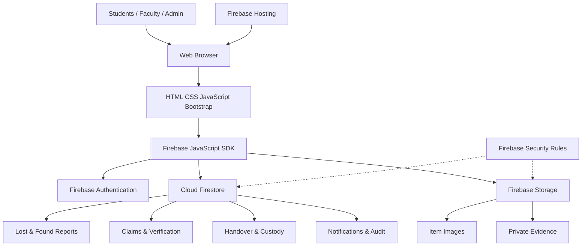
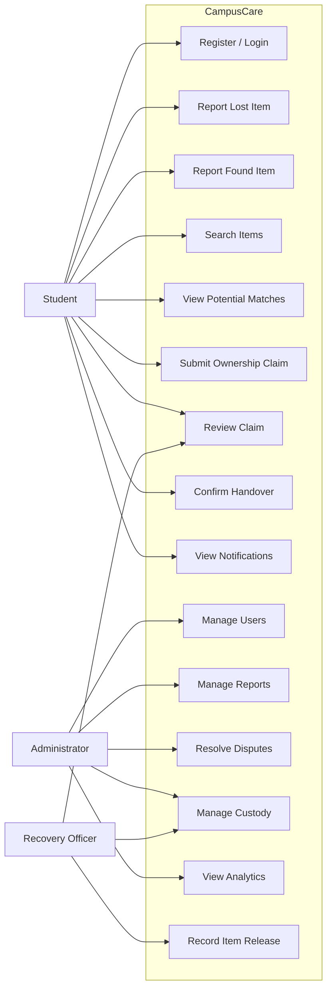
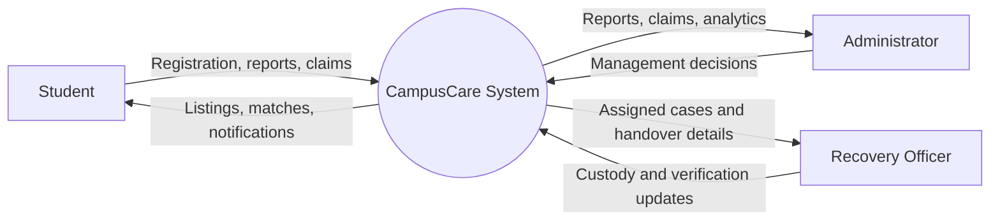
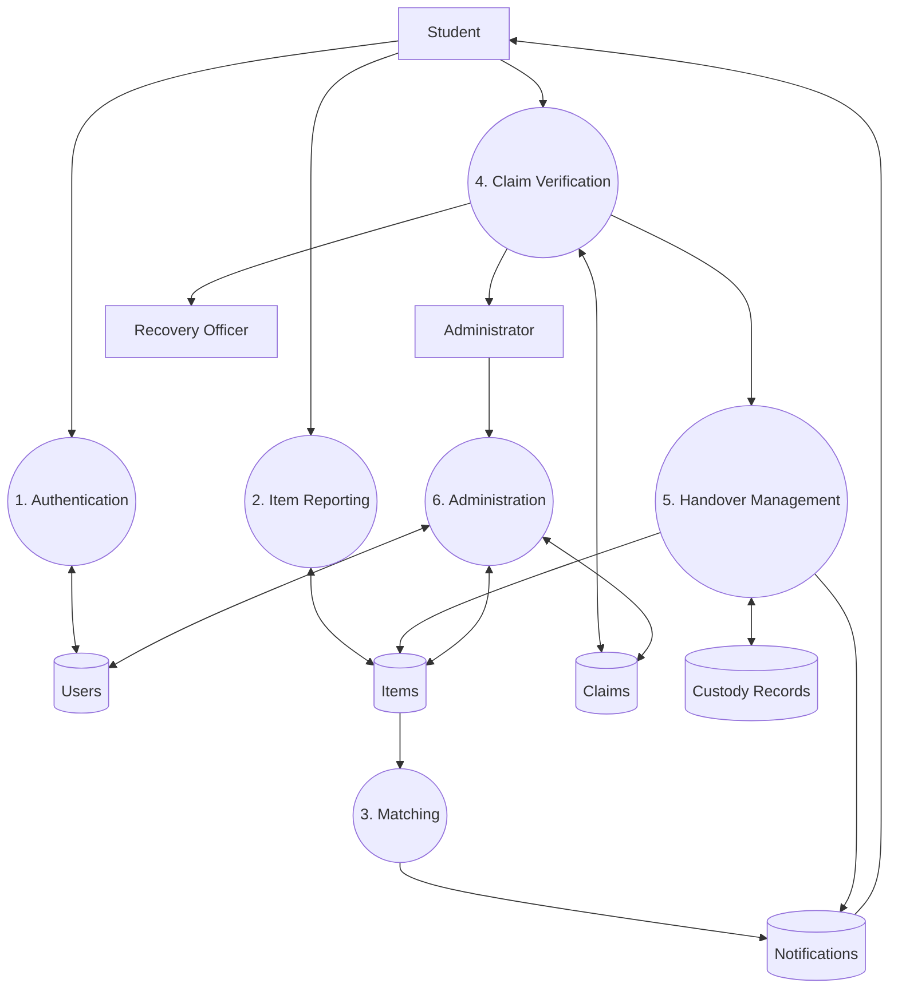
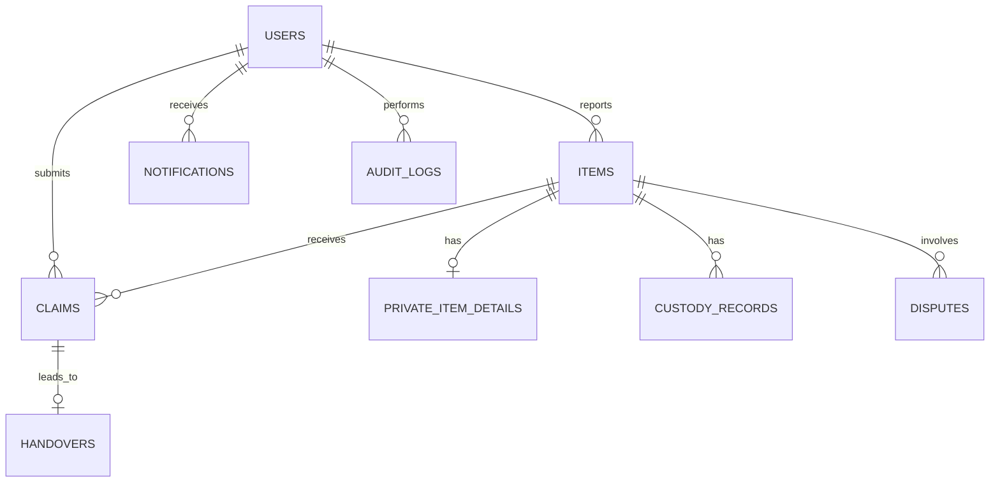
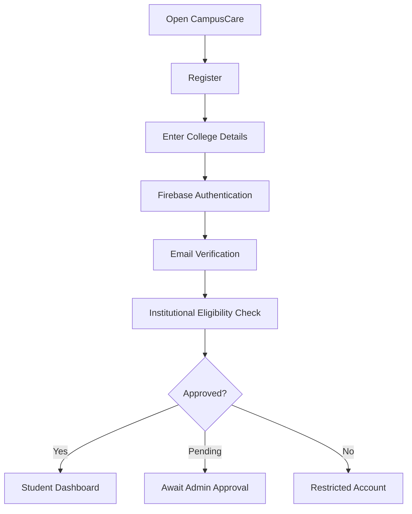
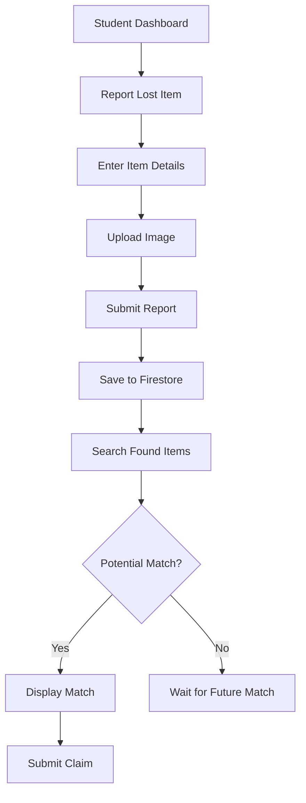
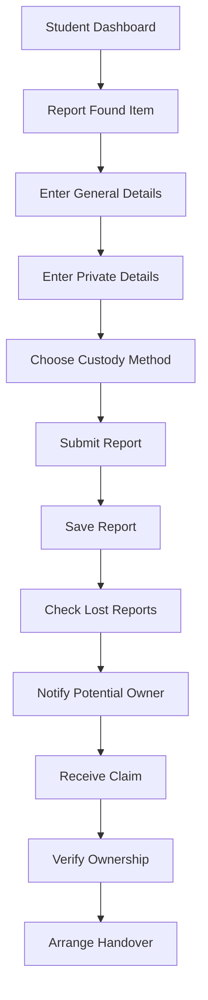
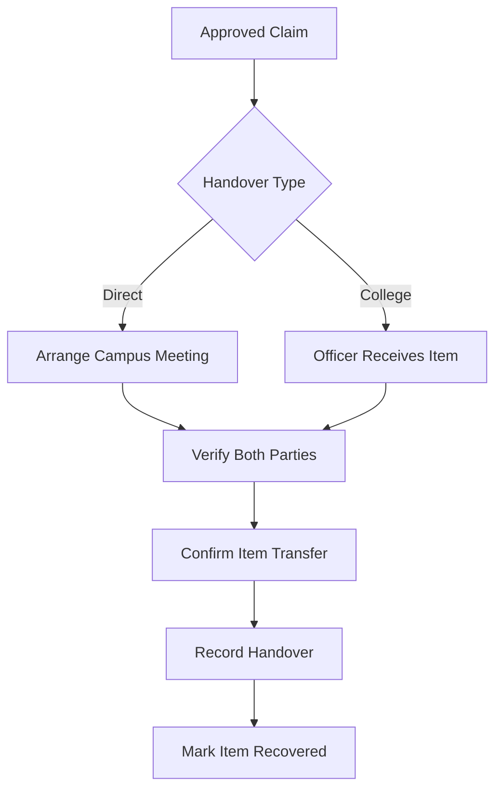

# CAMPUSCARE
# SYSTEM DESIGN DOCUMENT (SDD)
## Version 1.0 – Technical Architecture & Development Blueprint

**Project:** College Lost & Found Management System  
**Project Type:** MCA Academic Project  
**Frontend:** HTML5, CSS3, JavaScript, Bootstrap 5  
**Backend Services:** Firebase  
**Database:** Cloud Firestore  
**Authentication:** Firebase Authentication  
**Storage:** Firebase Storage  
**Hosting:** Firebase Hosting  
**Document Status:** Proposed – System Design

---

# 1. SYSTEM ARCHITECTURE

## 1.1 Architecture Overview

CampusCare will follow a client-side web application architecture supported by Firebase managed services.

The frontend will communicate with Firebase through its JavaScript SDK.

There will be no separate Python, PHP, Node.js or FastAPI backend in the initial version.

### Architecture diagram



## 1.2 Architecture Components

| Component | Responsibility |
|---|---|
| Web browser | Runs the CampusCare application |
| HTML | Page structure |
| CSS | Styling |
| Bootstrap | Responsive layout and UI components |
| JavaScript | Application logic and interactions |
| Firebase SDK | Communication with Firebase |
| Firebase Authentication | User identity |
| Cloud Firestore | Application data |
| Firebase Storage | Images and evidence files |
| Firebase Hosting | Application deployment |
| Firebase Security Rules | Database and storage authorization |

## 1.3 Architecture Design Principles

1. Keep the frontend modular.
2. Separate authentication logic from application logic.
3. Keep public and private information in separate documents.
4. Never expose administrative permissions to normal users.
5. Avoid unnecessary database reads.
6. Use Firestore transactions or trusted server-side operations for sensitive state transitions.
7. Maintain an audit trail for important activities.
8. Keep the initial implementation simple enough to understand and maintain.

---

# 2. USER ROLES AND PERMISSIONS

CampusCare will have three main application roles.

## 2.1 Student

A student can:

- Register and log in.
- View available lost and found listings.
- Report lost belongings.
- Report found belongings.
- Upload item photographs.
- Search and filter items.
- Submit ownership claims.
- Review claims on items they reported as found.
- Communicate with relevant users.
- Confirm successful handovers.
- View personal reports.
- View notifications.
- Report suspicious activity.

## 2.2 Administrator

An administrator can:

- View dashboard statistics.
- View registered users.
- Verify institutional accounts.
- Suspend accounts.
- View all item reports.
- Review claims.
- Handle disputed ownership.
- Assign recovery officers.
- View custody records.
- Manage item categories.
- View audit records.

## 2.3 Recovery Officer

A recovery officer can:

- View assigned recovery cases.
- Receive found items.
- Record physical custody.
- Review assigned ownership claims.
- Conduct in-person verification.
- Record item releases.
- Confirm completed handovers.

## 2.4 Permission matrix

| Function | Student | Finder | Admin | Officer |
|---|---|---|---|---|
| View public listings | Yes | Yes | Yes | Yes |
| Create lost report | Yes | Yes | Yes | Yes |
| Create found report | Yes | Yes | Yes | Yes |
| Submit claim | Yes | Yes | Yes | As assigned |
| Review own found-item claims | Yes | Yes | Yes | Yes |
| Review assigned sensitive claims | No | No | Yes | Yes |
| Manage users | No | No | Yes | No |
| Record custody | No | No | Yes | Yes |
| Confirm handover | Yes | Yes | Yes | Yes |
| View audit records | No | No | Yes | Limited |

**Important:** Finder and owner are transaction roles, not separate permanent account roles. The same student can perform both activities.

---

# 3. USE CASE DIAGRAM

## 3.1 Main use cases



## 3.2 Use Case Descriptions

### UC-01: Register Account

**Actor:** Student

Preconditions:
- User has a valid college email address.
- User has internet access.

Main flow:
1. User opens the registration page.
2. User enters registration information.
3. User submits the form.
4. Firebase Authentication creates the account.
5. Verification email is sent.
6. User verifies the email.
7. Application checks institutional eligibility.
8. User accesses the dashboard after required verification.

Alternative flow:
- Invalid email: Display error.
- Email already registered: Ask user to log in.
- Unverified account: Restrict protected access.
- Account awaiting college approval: Display pending status.

### UC-02: Report Lost Item

**Actor:** Student

Preconditions:
- User is authenticated.
- User is eligible to use the platform.

Main flow:
1. User opens Report Lost Item.
2. Enters item details.
3. Selects category.
4. Enters date and approximate location.
5. Uploads an optional image.
6. Submits the report.
7. System validates the data.
8. Firestore stores the report.
9. System checks possible found-item matches.
10. User receives a confirmation.

Postcondition:
- Lost report is created with a unique ID.

### UC-03: Report Found Item

**Actor:** Student

Main flow:
1. User opens Report Found Item.
2. Enters general item details.
3. Uploads a safe public image, if available.
4. Enters private identifying characteristics.
5. Selects custody arrangement.
6. Submits the report.
7. System creates a found-item record.
8. Matching process starts.
9. User receives confirmation.

### UC-04: Claim an Item

**Actor:** Student / Owner

Main flow:
1. User finds a potentially matching found item.
2. Opens the item details page.
3. Selects Claim This Item.
4. Provides identifying characteristics.
5. Uploads private evidence if necessary.
6. Submits the claim.
7. System records the claim as pending.
8. Finder or authorized officer receives a notification.
9. Claim is reviewed.

### UC-05: Verify Ownership

**Actor:** Finder / Recovery Officer / Admin

Main flow:
1. Reviewer opens the claim.
2. Reviews the claimant's evidence.
3. Compares evidence with private item details.
4. Requests additional evidence if required.
5. Approves for handover or rejects the claim.
6. System records the decision.

### UC-06: Complete Handover

**Actor:** Owner and Finder / Recovery Officer

Main flow:
1. Claim is approved for handover.
2. Handover type is selected.
3. Date and location are arranged.
4. Parties attend the handover.
5. Identity and item are checked.
6. Both parties confirm receipt and release.
7. Officer confirms if supervised.
8. System marks the item as recovered.

---

# 4. DATA FLOW DIAGRAMS (DFD)

## 4.1 DFD Level 0 – Context Diagram

This diagram shows the complete CampusCare system and its external users.



## 4.2 DFD Level 1 – Main Process



---

# 5. DATABASE DESIGN – FIRESTORE

## 5.1 Why Firestore?

Firestore is a document-oriented NoSQL database.

Unlike relational databases, it does not require traditional tables and joins.

CampusCare will organize information into collections and documents.

Example:

```text
campuscare/
│
├── users/
├── items/
├── privateItemDetails/
├── claims/
├── handovers/
├── custodyRecords/
├── notifications/
├── disputes/
├── categories/
├── colleges/
└── auditLogs/
```

Each collection contains documents identified by unique IDs.

## 5.2 Collection Design

### A. users

Purpose: Store registered user information.

Document ID: Firebase Authentication UID.

| Field | Type | Description |
|---|---|---|
| uid | String | User UID |
| fullName | String | Full name |
| email | String | College email |
| studentId | String | Institutional identifier |
| department | String | Department |
| course | String | Course |
| academicYear | String | Current academic year |
| role | String | student/admin/officer |
| verificationStatus | String | pending/verified/rejected |
| accountStatus | String | active/suspended |
| createdAt | Timestamp | Registration date |

Example:

```json
{
  "uid": "USER001",
  "fullName": "Rahul Sharma",
  "email": "rahul@college.edu",
  "studentId": "STU1024",
  "department": "MCA",
  "course": "MCA",
  "academicYear": "First Year",
  "role": "student",
  "verificationStatus": "verified",
  "accountStatus": "active"
}
```

### B. items

Purpose: Store lost and found reports.

Document ID: Auto-generated Firestore ID.

| Field | Type | Description |
|---|---|---|
| itemId | String | Unique item reference |
| title | String | Item title |
| itemType | String | lost/found |
| category | String | Item category |
| brand | String | Brand |
| colour | String | Colour |
| description | String | Public description |
| location | String | Approximate location |
| date | Timestamp | Lost/found date |
| imagePath | String | Storage path |
| reportedBy | String | User UID |
| custodyType | String | finder/college |
| status | String | active/claimed/recovered/closed |
| createdAt | Timestamp | Creation time |

Example:

```json
{
  "itemId": "ITEM001",
  "title": "Black Wireless Earbuds",
  "itemType": "found",
  "category": "Electronics",
  "brand": "Boat",
  "colour": "Black",
  "description": "Black wireless earbuds found near library",
  "location": "College Library",
  "reportedBy": "USER001",
  "custodyType": "finder",
  "status": "active"
}
```

### C. privateItemDetails

Purpose: Store private ownership information.

| Field | Type | Description |
|---|---|---|
| itemId | String | Associated item |
| privateDescription | String | Private details |
| distinctiveFeatures | String | Unique characteristics |
| serialInformation | String | Optional serial details |
| submittedBy | String | Finder UID |
| createdAt | Timestamp | Creation time |

Access:
- Authorized finder.
- Assigned recovery officer.
- Authorized administrator.

Ordinary students must never be able to read another user's private item details.

### D. claims

Purpose: Store ownership requests.

| Field | Type | Description |
|---|---|---|
| claimId | String | Claim ID |
| itemId | String | Found item reference |
| claimantId | String | Claimant UID |
| evidenceDescription | String | Ownership explanation |
| evidencePath | String | Private evidence path |
| status | String | pending/approved/rejected |
| reviewedBy | String | Reviewer UID |
| reviewReason | String | Review comments |
| createdAt | Timestamp | Submission time |

### E. handovers

Purpose: Store item recovery transactions.

| Field | Type | Description |
|---|---|---|
| handoverId | String | Handover ID |
| itemId | String | Item reference |
| claimId | String | Claim reference |
| ownerId | String | Owner UID |
| finderId | String | Finder UID |
| handoverType | String | direct/college |
| location | String | Handover location |
| scheduledAt | Timestamp | Scheduled time |
| ownerConfirmed | Boolean | Owner confirmation |
| finderConfirmed | Boolean | Finder confirmation |
| officerId | String | Officer UID |
| status | String | scheduled/completed/cancelled |
| completedAt | Timestamp | Completion time |

### F. custodyRecords

Purpose: Maintain physical custody history.

| Field | Type | Description |
|---|---|---|
| custodyId | String | Custody ID |
| itemId | String | Item reference |
| receivedBy | String | Receiving officer |
| releasedBy | String | Releasing officer |
| condition | String | Item condition |
| storageReference | String | Storage location reference |
| receivedAt | Timestamp | Receipt time |
| releasedAt | Timestamp | Release time |

Each transfer should create a new record. Do not overwrite previous custody history.

### G. notifications

Purpose: Notify users about important events.

| Field | Type | Description |
|---|---|---|
| notificationId | String | Notification ID |
| userId | String | Recipient UID |
| title | String | Notification title |
| message | String | Notification message |
| type | String | Notification type |
| isRead | Boolean | Read status |
| createdAt | Timestamp | Creation time |

### H. disputes

Purpose: Store complaints and conflicts.

| Field | Type | Description |
|---|---|---|
| disputeId | String | Dispute ID |
| itemId | String | Related item |
| claimId | String | Related claim |
| raisedBy | String | User UID |
| reason | String | Dispute reason |
| description | String | Explanation |
| status | String | open/in_review/resolved |
| assignedAdmin | String | Admin UID |
| resolution | String | Resolution details |
| createdAt | Timestamp | Creation time |

### I. categories

Example documents:

- Electronics
- Wallets and Purses
- Books and Stationery
- Identity Cards
- Bags
- Accessories
- Keys
- Other

### J. colleges

Purpose: Store institutional configuration.

Fields:
- collegeName
- collegeDomain
- collegeAddress
- approvedEmailDomains
- status
- createdAt

### K. auditLogs

Purpose: Maintain a record of important actions.

Fields:
- actorId
- action
- recordId
- recordType
- timestamp
- metadata

Sensitive operations should create audit records using trusted server-side logic.

## 5.3 Firestore Relationships

Although Firestore is NoSQL, the conceptual relationships are:



These are logical relationships, not traditional SQL foreign-key constraints. We will store IDs and references in Firestore documents.

## 5.4 Important Firestore Design Decisions

1. Use Firebase Auth UID as the user document ID.
2. Use Firestore-generated document IDs for reports and claims.
3. Store image paths rather than public image URLs.
4. Separate public item information from private evidence.
5. Use server timestamps for important events.
6. Use composite indexes for frequently combined filters.
7. Avoid downloading entire collections.
8. Use pagination for item listings.
9. Avoid duplicating sensitive information.
10. Use transactions or trusted backend operations for sensitive status changes.

---

# 6. MATCHING ALGORITHM DESIGN

## 6.1 Objective

When a student reports a lost item, the system should identify potentially matching found-item reports.

Version 1 will use a rule-based matching algorithm.

No AI model is required.

## 6.2 Matching Parameters

| Parameter | Matching logic |
|---|---|
| Category | Exact category match |
| Item name | Keyword similarity |
| Brand | Exact or similar brand |
| Colour | Matching colour |
| Date | Close date range |
| Location | Same or nearby campus area |
| Description | Common descriptive keywords |

## 6.3 Proposed Matching Score

| Parameter | Weight |
|---|---:|
| Category | 25 |
| Item name | 20 |
| Brand | 15 |
| Colour | 10 |
| Date proximity | 15 |
| Location proximity | 15 |
| Total | 100 |

Suggested interpretation:

- 75–100: Strong potential match.
- 50–74: Possible match.
- Below 50: Low similarity.

These are configurable similarity scores, not ownership probabilities.

## 6.4 Example

Lost report:

```text
Item: Boat Wireless Earbuds
Colour: Black
Category: Electronics
Location: Library
Date: 10 November
```

Found report:

```text
Item: Black Bluetooth Earbuds
Colour: Black
Category: Electronics
Location: Library
Date: 10 November
```

The matching engine may recommend these reports to each other.

The owner must still submit a claim and establish ownership.

---

# 7. APPLICATION WORKFLOW

## 7.1 Student Registration Flow



## 7.2 Lost Item Reporting Flow



## 7.3 Found Item Reporting Flow



## 7.4 Handover Flow



---

# 8. UI/UX DESIGN BLUEPRINT

## 8.1 Application Pages

| Page | Purpose | Access |
|---|---|---|
| index.html | Homepage | Public |
| login.html | User login | Public |
| register.html | Registration | Public |
| dashboard.html | Student dashboard | Student |
| lost-items.html | Browse lost reports | Student |
| found-items.html | Browse found reports | Student |
| report-lost.html | Submit lost report | Student |
| report-found.html | Submit found report | Student |
| item-details.html | View item details | Student |
| my-reports.html | Personal reports | Student |
| my-claims.html | Ownership claims | Student |
| notifications.html | Notifications | Student |
| profile.html | User profile | Student |
| admin/dashboard.html | Admin dashboard | Admin |
| admin/users.html | User management | Admin |
| admin/items.html | Report management | Admin |
| admin/claims.html | Claim verification | Admin |
| admin/custody.html | Custody management | Admin/Officer |
| admin/disputes.html | Dispute management | Admin |

## 8.2 Homepage Layout

Sections:

1. Navigation bar.
2. Hero section.
3. Search bar.
4. Report Lost Item button.
5. Report Found Item button.
6. How CampusCare Works.
7. Recently reported items.
8. Safety and privacy information.
9. Footer.

## 8.3 Student Dashboard

Recommended dashboard layout:

```text
------------------------------------------------
 CAMPUSCARE                 Profile | Logout
------------------------------------------------
 Welcome, Student!

 [Report Lost] [Report Found] [Search Items]

------------------------------------------------
 My Statistics
------------------------------------------------
 Lost Reports | Found Reports | Active Claims
------------------------------------------------
 Recent Activity
------------------------------------------------
 Potential Matches
------------------------------------------------
 Notifications
------------------------------------------------
```

## 8.4 Admin Dashboard

```text
------------------------------------------------
 CAMPUSCARE ADMIN
------------------------------------------------
 Dashboard | Users | Items | Claims | Custody
------------------------------------------------

 Total Users          Total Reports
 Pending Claims       Recovered Items

------------------------------------------------
 Pending Verification
------------------------------------------------
 Recent Reports
------------------------------------------------
 Active Disputes
------------------------------------------------
 Custody Records
------------------------------------------------
```

## 8.5 UI Design Guidelines

- Use a clean, professional dashboard design.
- Prefer a consistent colour palette.
- Use Bootstrap cards, modals and forms.
- Make the application responsive.
- Use clear status indicators.
- Show confirmation messages after successful operations.
- Avoid unnecessary animations.
- Use accessible labels and form validation.
- Ensure mobile users can complete all essential workflows.

---

# 9. FIREBASE SECURITY DESIGN

## 9.1 Authentication Security

- Require authentication for protected application functionality.
- Verify institutional email access.
- Restrict access to approved users.
- Use secure password reset.
- Validate account status.
- Restrict privileged roles.

## 9.2 Role-Based Access Control

The application will use three permanent roles:

- student
- admin
- officer

A student must never be able to change their own role by modifying a Firestore document.

Admin and officer permissions should be provisioned through a trusted setup process, preferably using Firebase custom claims or controlled server-side authorization.

## 9.3 Firestore Security Rules

Security rules must enforce:
- Authentication.
- Institutional eligibility.
- User-specific access.
- Role-specific access.
- Item ownership.
- Claim permissions.
- Private evidence restrictions.
- Restricted status changes.

The frontend is not a security boundary.

## 9.4 Storage Security

Storage requirements:
- Only authorized users can upload files.
- Maximum image size should be configured.
- Only approved file formats should be accepted.
- Private evidence must not be publicly accessible.
- File paths must be linked to authorized users and records.
- Unauthorized users must not be able to download evidence.

---

# 10. FIREBASE CONFIGURATION PLAN

## 10.1 Firebase Project Setup

1. Open Firebase Console.
2. Create a project named CampusCare.
3. Register a Web App.
4. Enable Authentication.
5. Enable email/password authentication.
6. Enable Firestore Database.
7. Enable Storage.
8. Configure Firebase Hosting.
9. Add authorized domains.
10. Configure security rules.

Firebase Console:
https://console.firebase.google.com/

Official documentation:

- Authentication: https://firebase.google.com/docs/auth
- Firestore: https://firebase.google.com/docs/firestore
- Storage: https://firebase.google.com/docs/storage
- Hosting: https://firebase.google.com/docs/hosting
- Security Rules: https://firebase.google.com/docs/rules

---

# 11. PROJECT FOLDER STRUCTURE

```text
CampusCare/
│
├── index.html
├── login.html
├── register.html
│
├── dashboard.html
├── lost-items.html
├── found-items.html
│
├── report-lost.html
├── report-found.html
├── item-details.html
│
├── my-reports.html
├── my-claims.html
├── notifications.html
├── profile.html
│
├── admin/
│   ├── dashboard.html
│   ├── users.html
│   ├── items.html
│   ├── claims.html
│   ├── custody.html
│   └── disputes.html
│
├── css/
│   ├── style.css
│   ├── auth.css
│   ├── dashboard.css
│   ├── forms.css
│   └── responsive.css
│
├── js/
│   ├── firebase-config.js
│   ├── auth.js
│   ├── auth-guard.js
│   ├── database.js
│   ├── storage.js
│   ├── items.js
│   ├── matching.js
│   ├── claims.js
│   ├── handovers.js
│   ├── custody.js
│   ├── notifications.js
│   └── admin.js
│
├── assets/
│   ├── images/
│   └── icons/
│
├── firestore.rules
├── storage.rules
├── firestore.indexes.json
└── README.md
```

The JavaScript files will use ES modules and imports. We should run the application through a local development server rather than opening HTML files directly using `file://`.

---

# 12. DEVELOPMENT ROADMAP

## Phase 1 – Project Foundation

Tasks:
- Create project folder.
- Set up Firebase.
- Create homepage.
- Create login page.
- Create registration page.
- Configure authentication.
- Implement role-based navigation.

Deliverable: Working registration and login.

## Phase 2 – Lost and Found Module

Tasks:
- Create student dashboard.
- Create lost-item form.
- Create found-item form.
- Connect Firestore.
- Implement image upload.
- Display reports.
- Implement search and filtering.

Deliverable: Working lost-and-found reporting system.

## Phase 3 – Matching Module

Tasks:
- Create matching logic.
- Compare category and keywords.
- Compare date and location.
- Display potential matches.
- Notify users of potential matches.

Deliverable: Working rule-based matching.

## Phase 4 – Claim and Verification

Tasks:
- Create claim submission form.
- Store private evidence.
- Implement claim review.
- Implement approval and rejection.
- Add admin verification.

Deliverable: Working ownership verification.

## Phase 5 – Handover and Admin

Tasks:
- Direct handover workflow.
- College office workflow.
- Custody records.
- Handover confirmation.
- Admin dashboard.
- Dispute management.
- Audit records.

Deliverable: Complete recovery workflow.

## Phase 6 – Testing and Deployment

Tasks:
- Test authentication.
- Test authorization.
- Test database rules.
- Test image privacy.
- Test all user journeys.
- Test responsive layouts.
- Deploy through Firebase Hosting.
- Prepare final demonstration.

Deliverable: Working CampusCare application.

---

# 13. PROJECT TESTING PLAN

## 13.1 Authentication Testing

- Register with valid college email.
- Register with invalid email.
- Verify email.
- Attempt login without verification.
- Reset password.
- Attempt unauthorized admin access.

## 13.2 Item Management Testing

- Submit lost item.
- Submit found item.
- Upload image.
- Edit own report.
- Attempt to modify another user's report.
- Search by category.
- Filter by date.
- Close a report.

## 13.3 Claim Testing

- Submit a valid claim.
- Submit incomplete evidence.
- Submit duplicate claims.
- Approve a claim.
- Reject a claim.
- Attempt unauthorized claim access.

## 13.4 Recovery Testing

- Complete direct handover.
- Complete college-office handover.
- Record custody.
- Confirm item release.
- Attempt unauthorized release.
- Verify audit records.

## 13.5 Security Testing

- Try accessing another user's private evidence.
- Try changing the role field.
- Try reading another college's records.
- Try modifying a completed handover.
- Try uploading an unsupported file.
- Try accessing Firestore without authentication.

All security tests must be performed using the Firebase Emulator Suite and authorized test accounts.

---

# 14. FINAL DEVELOPMENT DECISIONS

| Area | Final choice |
|---|---|
| Project name | CampusCare |
| Application type | Responsive web application |
| Frontend | HTML5, CSS3, JavaScript |
| UI framework | Bootstrap 5 |
| Database | Cloud Firestore |
| Authentication | Firebase Authentication |
| Storage | Firebase Storage |
| Hosting | Firebase Hosting |
| Architecture | Firebase-managed backend services |
| Matching | Rule-based |
| Ownership verification | Finder + authorized human review |
| Recovery | Hybrid |
| Rewards | Optional, outside the platform |
| Collateral | None |
| Payment gateway | Not required |
| AI integration | Not in initial release |

---

# 15. FINAL SYSTEM DESIGN SUMMARY

CampusCare will provide a simple and secure digital platform for managing college lost-and-found activities.

Students can report missing belongings, register found items, search listings and submit ownership claims.

The system identifies potential matches through rule-based comparison. Ownership is verified through item-specific evidence and human review where necessary.

Ordinary belongings can be handed over directly at a safe campus location, while valuable or sensitive belongings are handled through an authorized college recovery officer.

Firebase provides authentication, database management, file storage and application hosting.

The system will maintain records of reports, claims, custody and successful handovers.

The initial implementation will focus on reliability, privacy, security and simplicity rather than unnecessary advanced features.

**End of System Design Document – CampusCare v1.0**